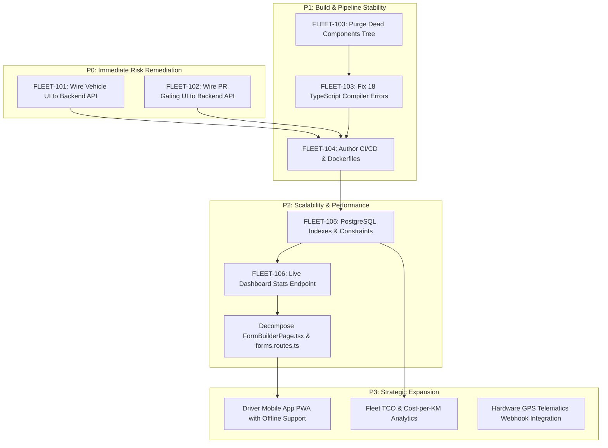

# Hulma Integrated Fleet Logistics & Maintenance Management System

# Master Application Audit & Implementation Roadmap

**Document Version:** 1.0.0  
**Audit Date:** 2026-10-14  
**Auditing Body:** Unified Executive & Technical Review Board  
_(Fortune 500 CEO, CTO, CPO, Principal Software Architect, Senior Full-Stack Engineer, Application Security Engineer, QA Automation Lead, UX/UI Designer, DevOps/SRE, and Business Growth Strategist)_  
**Primary Artifacts:** [`docs/AUDIT_AND_IMPLEMENTATION_ROADMAP.md`](AUDIT_AND_IMPLEMENTATION_ROADMAP.md) | [PROJECT_CONTEXT.md](../PROJECT_CONTEXT.md) | [ARCHITECTURE.md](../ARCHITECTURE.md) | [HYBRID_AUTH.md](HYBRID_AUTH.md)

---

## Table of Contents

1. [Deliverable A: Executive Summary & Scorecard](#deliverable-a-executive-summary--scorecard)
2. [Deliverable B: Application Inventory](#deliverable-b-application-inventory)
3. [Deliverable C: Findings Register](#deliverable-c-findings-register)
4. [Deliverable D: Prioritized Improvement Roadmap](#deliverable-d-prioritized-improvement-roadmap)
5. [Deliverable E: Feature Opportunity Matrix](#deliverable-e-feature-opportunity-matrix)
6. [Deliverable F: Technical Improvement Plan](#deliverable-f-technical-improvement-plan)
7. [Deliverable G: User Experience & UI Review](#deliverable-g-user-experience--ui-review)
8. [Deliverable H: Reliability, Security & Compliance Plan](#deliverable-h-reliability-security--compliance-plan)
9. [Deliverable I: Metrics & Scorecard](#deliverable-i-metrics--scorecard)
10. [Deliverable J: 30 / 60 / 90-Day Strategic Roadmap](#deliverable-j-30--60--90-day-strategic-roadmap)
11. [Deliverable K: Top 5 Quick Wins](#deliverable-k-top-5-quick-wins)
12. [Deliverable L: Implementation Backlog & Sprint Tickets](#deliverable-l-implementation-backlog--sprint-tickets)
13. [Deliverable M: Open Questions & Strategic Resolutions](#deliverable-m-open-questions--strategic-resolutions)

---

## Deliverable A: Executive Summary & Scorecard

### A.1 Commercial & Operational Purpose

The **Hulma Integrated Fleet Logistics & Maintenance Management System** is an enterprise-grade digital platform engineered to eliminate vehicle downtime, enforce preventive maintenance accountability, and impose strict financial controls over logistics repair expenditures across the organization.

The platform modernizes and centralizes vehicle operations, directly replacing paper vouchers (Transportation Service Request Forms — TSRF) and informal, un-audited group messaging communications (e.g., _"Hulma - Vehicle PMS & Repair (Fleet)"_) with an automated, auditable, multi-tiered digital pipeline.

### A.2 Core Domain Pillars

- **Module A: Transportation Service Request (TSRF) & Logistics Engine:** Digital intake portal, configurable 4:00 PM cutoff enforcement, multi-stop route management, driver/passenger manifests, and multi-tier department approval hierarchies.
- **Module B: Fleet Inventory & 5,000 KM PMS Enforcement:** Real-time odometer tracking, automatic 5,000 KM Preventive Maintenance Service (PMS) threshold alerts, and mandatory Incident Report gating before repair orders can be approved for overdue vehicles.
- **Module C: PR Gating & Procurement Engine:** Mandatory Purchase Requisition (PR) approval as a hard system gate before maintenance and repair work orders can be unlocked and fulfilled by external suppliers.
- **Dynamic Form & LOV Infrastructure:** Schema-versioned form builder with stage-based field visibility, nested read/write permissions, immutable published field keys, and generic List-of-Values (LOV) catalogs.

### A.3 Executive Verdict & System Maturity

- **Composite Score:** **6.4 / 10** (Strong Enterprise Foundation with Critical Architectural Debt).
- **Key Strengths:**
  - 134 automated unit and integration tests passing across backend (59) and frontend (75).
  - Enterprise-grade hybrid authentication with Argon2id, HTTP-only session cookies, double-submit CSRF defense, and Azure MSAL browser integration.
  - Robust transactional integrity using PostgreSQL advisory locks (`pg_advisory_lock` for migrations, form publishing, and stage transitions).
  - Advanced dynamic Form Builder and versioned submission engine with field-level visibility masking and non-PII reporting projections.
- **Key Vulnerabilities:**
  - _Core UI State Disconnection (P0 Critical):_ Primary Vehicle Registry and PR Gating dashboard views in `src/App.tsx` operate on in-memory React `useState` rather than persisting to PostgreSQL REST endpoints.
  - _Massive Code Duplication (P1 High):_ 14.55% code clone duplication (4,738 duplicate lines) caused by an orphaned legacy `components/` directory in the repository root.
  - _Broken Frontend TypeScript Compilation (P1 High):_ 18 errors during `npx tsc --noEmit` primarily caused by lazy-load import typing mismatches.
  - _DevOps & Observability Gap (P1 High):_ Absence of CI/CD pipelines, Docker containerization, automated backup scripts, and centralized APM telemetry.

---

## Deliverable B: Application Inventory

| Dimension              | Verified Fact                                                                        | Source & Evidence                                                                                                    |
| :--------------------- | :----------------------------------------------------------------------------------- | :------------------------------------------------------------------------------------------------------------------- |
| **Frontend Framework** | React 19.3.0, Vite 4.7.0, React Router DOM 7.18.4, Tailwind CSS 3.4.19               | [`package.json`](../package.json), [`vite.config.ts`](../vite.config.ts)                                             |
| **Backend Framework**  | Node.js, Express 5.0.1, TSX runtime watcher (`tsx watch src/server.ts`)              | [`fleet-backend/package.json`](../../fleet-backend/package.json), [`server.ts`](../../fleet-backend/src/server.ts)   |
| **Database & ORM**     | PostgreSQL 16 (port 5432, `FleetDB`), Drizzle ORM 0.45.3, `node-postgres` driver     | [`schema.ts`](../../fleet-backend/src/db/schema.ts), [`connection.ts`](../../fleet-backend/src/db/connection.ts)     |
| **Security Layer**     | Arcjet 1.5.0 (bot detection & rate limiting), CASL ability rules, Argon2id           | [`auth.ts`](../../fleet-backend/src/middleware/auth.ts), [`arcjet.ts`](../../fleet-backend/src/middleware/arcjet.ts) |
| **API Contract Sync**  | Drizzle Tables -> Drizzle-Zod Schemas -> OpenAPI 3.0 -> `openapi-typescript`         | [`openapi.ts`](../src/api/openapi.ts), [`generated-types.ts`](../src/api/generated-types.ts)                         |
| **Automated Testing**  | Vitest 2.1.9, React Testing Library, Supertest                                       | 134 passing tests (59 backend, 75 frontend)                                                                          |
| **UI State Layer**     | Hybrid: Form Builder & Reports use `apiFetch`; Fleet & PR views use React `useState` | [`App.tsx:250-321`](../src/App.tsx#L250-L321)                                                                        |
| **Deployment / CI**    | Local Husky 9.1.7 Git hooks; no `.github/workflows`, no Dockerfile                   | Root directories of both repos                                                                                       |

---

## Deliverable C: Findings Register

### `FINDING-001`: Core Fleet & Procurement Views Disconnected from Database

- **Category:** Architecture & Data Integrity
- **Severity:** **P0 - Critical Defect**
- **Affected Files:** [`src/App.tsx:250-321, 337-550`](../src/App.tsx#L250-L321)
- **Root Cause:** In `src/App.tsx`, `vehicles`, `prs`, and `workOrders` are instantiated using local `useState` with hardcoded seed objects. Handlers (`handleLogMileage`, `handleApprovePr`, `handleUnlockWorkOrder`) modify local React state and call `addLog` for local UI notifications, but never execute HTTP requests against `/api/vehicles`, `/api/procurement`, or `/api/maintenance`.
- **Business Impact:** Any odometer update, repair dispatch, or PR approval performed in the primary user dashboard is completely lost upon page reload or session switch.
- **Technical Impact:** The frontend fails to utilize the PostgreSQL tables and Express services specifically built for Modules B and C.
- **Recommended Fix:** Refactor `FleetPage` and `ProcurementPage` to fetch records via `apiFetch` from `/api/vehicles`, `/api/procurement`, and `/api/maintenance`. Update handlers to dispatch asynchronous API mutations.
- **Effort Estimate:** 8–12 hours.
- **Validation Method:** Log vehicle mileage in UI, reload browser, verify database record via `SELECT current_km FROM vehicles WHERE plate_number = '...'`.

### `FINDING-002`: Frontend TypeScript Compilation Failures (`tsc --noEmit`)

- **Category:** Code Quality & Build Health
- **Severity:** **P1 - High**
- **Affected Files:** [`src/App.tsx:18-76`](../src/App.tsx#L18-L76), [`src/features/form-builder/FormBuilderPage.tsx:498, 555, 1807, 2111`](../src/features/form-builder/FormBuilderPage.tsx#L498), [`src/features/form-builder/registry.tsx:72`](../src/features/form-builder/registry.tsx#L72), [`src/features/form-builder/TSRFDetailView.tsx:802`](../src/features/form-builder/TSRFDetailView.tsx#L802), [`src/features/maintenance/ReferenceDataPage.tsx:425`](../src/features/maintenance/ReferenceDataPage.tsx#L425)
- **Root Cause:** 18 TypeScript errors exist in the codebase:
  1. 10 lazy import statements in `App.tsx` assume `m.default` exists on named-export modules.
  2. `FormWorkflow` type requires `cutoff` property, which is omitted in FormBuilderPage seed/default workflow builders.
  3. `FormDefinition` type mismatches (`id` vs `key`, missing `title`).
  4. Non-null assertion missing on regex match iterator in `registry.tsx`.
- **Business Impact:** Automated CI/CD deployment pipelines will break; risk of runtime `TypeError` in unexercised edge cases.
- **Technical Impact:** Type safety is bypassed; build pipeline cannot be automated until clean.
- **Recommended Fix:** Correct lazy module wrapper signatures `then((m) => ({ default: m.ComponentName }))`, supply default `cutoff` objects, and align interface definitions.
- **Effort Estimate:** 3–5 hours.
- **Validation Method:** Run `npx tsc --noEmit` and confirm 0 errors.

### `FINDING-003`: Massive Code Duplication & Orphaned Component Tree

- **Category:** Technical Debt & Maintainability
- **Severity:** **P1 - High**
- **Affected Files:** Root directory [`components/`](../components) (29 files, 4,738 duplicated lines)
- **Root Cause:** A legacy components tree remains in the root folder alongside the migrated DDD structure in `src/features/` and `src/components/`. `jscpd` detects 152 duplicated code clones (14.55% of the entire codebase). Knip detects 29 completely unused files in `components/`. ESLint reports 36 warnings/errors, 27 of which originate from this dead tree.
- **Business Impact:** High developer confusion, risk of editing the wrong file, elevated maintenance overhead, and bloated repository size.
- **Recommended Fix:** Completely delete the root `components/` directory. Verify all active application imports resolve cleanly from `@/components` (`src/components`) and `@/features` (`src/features`).
- **Effort Estimate:** 1–2 hours.
- **Validation Method:** Run `npm run lint:unused` (Knip), `npm run lint:dup` (jscpd), and `npm run lint` (ESLint).

### `FINDING-004`: Monolithic Files Impeding Maintainability

- **Category:** Architecture & Modularity
- **Severity:** **P2 - Medium**
- **Affected Files:** [`src/features/form-builder/FormBuilderPage.tsx`](../src/features/form-builder/FormBuilderPage.tsx) (4,825 lines / 208 KB), [`fleet-backend/src/routes/forms.routes.ts`](../../fleet-backend/src/routes/forms.routes.ts) (2,815 lines / 95 KB)
- **Root Cause:** Multiple distinct architectural responsibilities (palette rendering, drag-and-drop canvas, workflow state management, diffing, field drawers, validation) are consolidated into single giant files.
- **Business Impact:** Severe developer friction, frequent merge conflicts during concurrent feature development, and high cognitive load.
- **Recommended Fix:**
  - Decompose `FormBuilderPage.tsx` into modular subcomponents: `FieldPaletteSidebar.tsx`, `FormCanvas.tsx`, `FieldConfigDrawer.tsx`, `WorkflowStageMatrix.tsx`, and `VersionDiffModal.tsx`.
  - Decompose `forms.routes.ts` into discrete Express controllers.
- **Effort Estimate:** 16–24 hours.
- **Validation Method:** Automated tests in `formBuilder.test.ts` and `form-definition.test.ts` pass without regression.

### `FINDING-005`: Missing Foreign Key Indexes & Schema Drift in Postgres

- **Category:** Database Performance & Scalability
- **Severity:** **P2 - Medium**
- **Affected Files:** [`fleet-backend/src/db/schema.ts`](../../fleet-backend/src/db/schema.ts), [`fleet-backend/src/db/migrate.ts`](../../fleet-backend/src/db/migrate.ts)
- **Root Cause:**
  1. Relational foreign key columns (`vehicle_id` on `pms_records`, `repair_work_orders`, `incident_reports`; `submission_id` on `form_submission_events`) lack explicit B-Tree indexes.
  2. JSON data columns (`stops_json`, `passengers_json`, `data_json`) are defined as plain `text` rather than native PostgreSQL `jsonb`.
  3. `lov_items` declares `UNIQUE (list_id, code)` in `migrate.ts` DDL, but this constraint is omitted in Drizzle's `schema.ts`.
- **Business Impact:** As historical trip manifests and form submissions scale past 10,000 records, dashboard queries and submission filtering will experience exponential response time degradation.
- **Recommended Fix:** Author a migration adding explicit indexes on all foreign keys and compound indexes on `form_submissions(form_version_id, status, created_at DESC)`. Align Drizzle ORM schema with database constraints.
- **Effort Estimate:** 4–6 hours.
- **Validation Method:** Execute `EXPLAIN ANALYZE` on submission reporting queries and verify Index Scans.

### `FINDING-006`: Absence of Automated CI/CD Pipelines & Containerization

- **Category:** DevOps & Operational SRE
- **Severity:** **P1 - High**
- **Affected Files:** Missing `.github/workflows/ci.yml`, `Dockerfile`, `docker-compose.yml`
- **Root Cause:** Testing and linting are currently enforced solely via client-side Husky Git hooks. No server-side CI runner validates pull requests. Deployment instructions rely on manual local execution.
- **Business Impact:** Risk of deploying broken builds to production; lack of environment reproducibility across development, staging, and production tiers.
- **Recommended Fix:** Create GitHub Actions CI workflow executing `lint`, `typecheck`, and `test` across both repositories on every PR. Author production-ready Dockerfiles (multi-stage Nginx for frontend; Node Alpine for backend).
- **Effort Estimate:** 6–8 hours.
- **Validation Method:** Trigger GitHub Actions pipeline on branch push; execute `docker compose up --build`.

### `FINDING-007`: Hardcoded Dashboard Statistics

- **Category:** UX & Data Accuracy
- **Severity:** **P2 - Medium**
- **Affected Files:** [`src/features/dashboard/DashboardOverview.tsx:40-85`](../src/features/dashboard/DashboardOverview.tsx#L40-L85)
- **Root Cause:** The KPI cards on the main executive hub ("Active Vehicles: 8", "PMS Alerts: 2", "Pending PRs: 3", "Open TSRFs: 5") and the recent activity list are hardcoded static numbers.
- **Business Impact:** Executives and fleet managers viewing the dashboard do not see real-time operational status.
- **Recommended Fix:** Implement an aggregation endpoint `GET /api/dashboard/stats` returning live counts directly from PostgreSQL, and wire `DashboardOverview.tsx` to consume this endpoint.
- **Effort Estimate:** 4–6 hours.
- **Validation Method:** Register a new vehicle or file a TSRF; verify dashboard counters increment dynamically.

### `FINDING-008`: Lack of Offline Resilience & Mobile Adaptation for Fleet Drivers

- **Category:** Product Strategy & Usability
- **Severity:** **P2 - Medium**
- **Affected Files:** [`src/features/fleet/VehicleRegistryTable.tsx`](../src/features/fleet/VehicleRegistryTable.tsx), [`src/features/form-builder/PublishedTsrfForm.tsx`](../src/features/form-builder/PublishedTsrfForm.tsx)
- **Root Cause:** The interface is optimized for desktop administrative screens with wide data tables. Drivers operating in field conditions have poor mobile responsiveness and no offline fallback.
- **Business Impact:** Drivers fail to log odometer updates in real-time when returning vehicles, delaying PMS alert triggers.
- **Recommended Fix:** Implement responsive card layouts for mobile viewports (`< 768px`) and prepare a dedicated Driver Mobile PWA interface with service-worker offline caching.
- **Effort Estimate:** 16–24 hours.
- **Validation Method:** Emulate mobile devices in browser DevTools and verify clean vertical card presentation.

---

## Deliverable D: Prioritized Improvement Roadmap



---

## Deliverable E: Feature Opportunity Matrix

| Feature Proposal                                    | Target User                          | Problem Solved                                                               | Expected Business Value                                            | Implementation Complexity                     | Risks & Trade-offs                     | Decision                                |
| :-------------------------------------------------- | :----------------------------------- | :--------------------------------------------------------------------------- | :----------------------------------------------------------------- | :-------------------------------------------- | :------------------------------------- | :-------------------------------------- |
| **Direct Backend Persistence for Fleet & PRs**      | Fleet Managers, Procurement Officers | Edits in UI vanish on page reload                                            | High (Restores core system value & trust)                          | Low (APIs already exist on backend)           | Low                                    | **Build Now (P0)**                      |
| **Driver Mobile Quick-Log Application (PWA)**       | Fleet Drivers, 3PL Drivers           | In-cab odometer logging and manifest checks are awkward on desktop web       | High (Enables real-time KM logging; improves PMS trigger accuracy) | Medium (PWA + Service Worker)                 | Low                                    | **Build in Phase 2**                    |
| **Fleet TCO & Maintenance Cost-per-KM Analytics**   | CFO, Finance Managers, Fleet Heads   | Unclear which vehicle models or routes drive the highest repair costs        | High (Direct financial optimization and fleet renewal decisions)   | Medium (Drizzle aggregation queries)          | Low                                    | **Build in Phase 3**                    |
| **Third-Party Telematics / GPS Hardware Ingestion** | Dispatchers, Logistics Heads         | Drivers forgetting to log ending KM on return                                | High (Full automation of mileage tracking)                         | High (Requires external hardware procurement) | Hardware reliability / vendor lock-in  | **Deferred to Future Enterprise Phase** |
| **Configurable Audit Retention Engine**             | Legal, Compliance, Auditors          | Inability to adjust data lifecycle per regulatory guidelines                 | High (Ensures enterprise compliance without code changes)          | Low (Configurable days + background archival) | Accidental data purge if misconfigured | **Build in Phase 2**                    |
| **Multi-Subsidiary Tenant Partitioning**            | Group IT, Subsidiary Admins          | Future expansion to multiple sister companies without database fragmentation | High (Future enterprise expansion)                                 | Medium (`organization_id` partitioning)       | Increased query complexity             | **Prepare Schemas Now; Rollout Later**  |

---

## Deliverable F: Technical Improvement Plan

### F.1 Architecture & State Decoupling

- **State Management Refactoring:** Deprecate top-level state hoisting in [`App.tsx`](../src/App.tsx). Implement TanStack React Query (`@tanstack/react-query`) or custom lightweight `useVehicleData` and `useProcurementData` hooks using [`apiFetch`](../src/lib/api.ts).
- **Component Decomposition:**
  - Break [`FormBuilderPage.tsx`](../src/features/form-builder/FormBuilderPage.tsx) (4,825 lines) into:
    - `FieldPaletteSidebar.tsx`: Left toolbar with draggable items.
    - `FormCanvas.tsx`: Visual layout drop target and section reordering.
    - `FieldConfigDrawer.tsx`: Field attribute, rule, and LOV binding controls.
    - `WorkflowStageMatrix.tsx`: Stage permissions and transition diagram.
    - `VersionDiffModal.tsx`: Version diff inspection modal.
- **Controller-Service Pattern:** Decompose [`forms.routes.ts`](../../fleet-backend/src/routes/forms.routes.ts) (2,815 lines) into `form-definition.controller.ts`, `form-submission.controller.ts`, and `form-access.controller.ts`.

### F.2 Database & Query Optimization

- **Add Missing B-Tree Indexes in PostgreSQL:**
  ```sql
  CREATE INDEX IF NOT EXISTS idx_pms_records_vehicle ON pms_records(vehicle_id);
  CREATE INDEX IF NOT EXISTS idx_repair_work_orders_vehicle ON repair_work_orders(vehicle_id);
  CREATE INDEX IF NOT EXISTS idx_repair_work_orders_pr ON repair_work_orders(linked_pr_id);
  CREATE INDEX IF NOT EXISTS idx_incident_reports_vehicle ON incident_reports(vehicle_id);
  CREATE INDEX IF NOT EXISTS idx_form_submissions_lookup ON form_submissions(form_version_id, status, created_at DESC);
  CREATE INDEX IF NOT EXISTS idx_form_submission_events_submission ON form_submission_events(submission_id, created_at ASC);
  CREATE INDEX IF NOT EXISTS idx_activity_logs_created_at ON activity_logs(created_at DESC);
  ```

---

## Deliverable G: User Experience & UI Review

### G.1 UX Strengths

- **Tailwind Design System & Theme Engine:** Dark and light mode implementation via CSS custom properties and HSL variables is well executed, with dynamic preview and persistent local storage.
- **Workflow Diagram Preview:** The interactive SVG-based state transition diagram in [`WorkflowDiagramPreview.tsx`](../src/features/form-builder/WorkflowDiagramPreview.tsx) provides immediate visual feedback on approval stages.
- **Print View Fidelity:** Dedicated print view ([`FormPrintView.tsx`](../src/features/form-builder/FormPrintView.tsx)) matches standard enterprise paper vouchers, including approval signature stamp blocks.

### G.2 Friction Points & Solutions

1. **Empty States:** When zero submissions or vehicles exist, tables display blank whitespace. Provide illustrated empty states with direct call-to-action buttons (`"Submit your first TSRF"`).
2. **Cutoff Alerting:** Warn requesters _before_ they begin filling out a TSRF if current time exceeds 4:00 PM Asia/Manila, indicating that Department Head justification will be mandatory.
3. **Responsive Mobile Tables:** Provide responsive card views for tables on screens `< 768px` to support drivers operating from smartphones.

---

## Deliverable H: Reliability, Security & Compliance Plan

### H.1 Risk-Ranked Security Safeguards

1. **Argon2id & Session Cookies (Verified Implemented):** Password hashing uses Argon2id; sessions are bound to HTTP-only, SameSite cookies with cryptographically random token hashes.
2. **Strict CSRF Validation (Verified Implemented):** Non-idempotent requests (POST, PUT, DELETE) require a matching `X-CSRF-Token` header validated against the hashed session token via constant-time comparison (`timingSafeEqual`).
3. **Arcjet Defense in Depth (Partially Configured):** Backend enforces bot protection on intake and rate-limiting on sensitive write routes. Production must fail closed if `ARCJET_KEY` is omitted.
4. **Data Retention & Privacy Enforcement (Verified Implemented):** Reporting engine explicitly masks non-reportable fields and projects sanitized snapshots, preventing PII leaks to unauthorized roles.

### H.2 Operational Disaster Recovery Measures

- **Automated PostgreSQL Snapshots:** Schedule daily `pg_dump` jobs retained for 30 days, with Write-Ahead Logging (WAL) archiving enabled for point-in-time recovery (PITR).
- **Graceful Shutdown Handling:** Add SIGTERM/SIGINT handlers in [`server.ts`](../../fleet-backend/src/server.ts) to gracefully drain Express connections and close the `pg.Pool`.

---

## Deliverable I: Metrics & Scorecard

_Ratings on a 1–10 scale based on verified repository evidence:_

| Dimension                          | Score (1–10) | Confidence | Primary Evidence & Assessment Gaps                                                                     |
| :--------------------------------- | :----------: | :--------: | :----------------------------------------------------------------------------------------------------- |
| **1. Business Strategy**           |  **7 / 10**  |    High    | Clear, high-value problem definition (PMS + PR gating); lacks monetization & multi-tenant roadmap.     |
| **2. Product & Features**          |  **8 / 10**  |    High    | Rich form builder, versioning, and approval workflows. Deducted for Fleet/PR UI state disconnection.   |
| **3. Architecture & Code Quality** |  **5 / 10**  |    High    | 14.5% code clone duplication, dead `components/` directory, 4,800+ line monolithic files.              |
| **4. Security & Privacy**          |  **8 / 10**  |    High    | Argon2id, CSRF tokens, CASL authorization, PII projection filters. Staging verification pending.       |
| **5. Performance & Scalability**   |  **6 / 10**  |   Medium   | Low query volume is fine; missing DB indexes and heavy JSON text parsing will bottleneck scale.        |
| **6. Database & Data Integrity**   |  **7 / 10**  |    High    | Strong advisory locks and ACID transactions; schema drift on `lov_items` unique index.                 |
| **7. UX/UI & Accessibility**       |  **7 / 10**  |   Medium   | Polished dark mode and print views; lacks mobile table adaptation and rich empty states.               |
| **8. Reliability & Operations**    |  **4 / 10**  |    High    | Zero CI/CD pipelines, no Docker containerization, no automated backups or APM tooling.                 |
| **9. Quality Assurance**           |  **7 / 10**  |    High    | 134 automated tests passing (59 backend + 75 frontend). Frontend typecheck (`tsc`) currently failing.  |
| **10. BI & Growth Analytics**      |  **5 / 10**  |    High    | Solid submission reporting and CSV export; no user telemetry or product analytics.                     |
| **11. Industry Best Practices**    |  **6 / 10**  |    High    | Adheres to modern TypeScript/React/Express patterns; penalized for orphaned code and monolithic files. |
| **OVERALL COMPOSITE SCORE**        | **6.4 / 10** |  **High**  | **Solid enterprise foundation with critical maintenance debt and frontend persistence gaps.**          |

---

## Deliverable J: 30 / 60 / 90-Day Strategic Roadmap

### Days 1–30: Risk Reduction & Baseline Hardening

- **Week 1:** Wire frontend `FleetPage` and `ProcurementPage` to backend REST endpoints; verify end-to-end data persistence in PostgreSQL (`FLEET-101`, `FLEET-102`).
- **Week 2:** Fix the 18 frontend TypeScript errors in `tsc --noEmit`. Delete the dead root `components/` folder to eliminate 4,700+ lines of duplicate code (`FLEET-103`).
- **Week 3:** Add missing PostgreSQL foreign key indexes and convert JSON columns to `jsonb` (`FLEET-105`).
- **Week 4:** Set up Docker containerization and GitHub Actions automated testing on PRs (`FLEET-104`).

### Days 31–60: Foundational Refactoring & UX Polish

- **Weeks 5–6:** Decompose `FormBuilderPage.tsx` into 5 cohesive subcomponents.
- **Weeks 7–8:** Refactor `forms.routes.ts` into modular controllers.
- **Weeks 9–10:** Implement responsive mobile card layouts for vehicle tables and add rich empty states.
- **Weeks 11–12:** Verify staging deployment with real Azure Entra ID and SMTP mailer.

### Days 61–90: Strategic Growth & Automation

- **Month 3:** Build Driver Mobile Quick-Log interface (PWA) with offline support.
- **Month 3:** Develop Fleet TCO & Maintenance Cost-per-Kilometer analytics dashboard.
- **Month 3:** Pilot third-party telematics/GPS integration for automated odometer syncing.

---

## Deliverable K: Top 5 Quick Wins

1. **Delete Orphaned Root `components/` Directory:**
   - _Effort:_ 15 minutes.
   - _Impact:_ Instantly eliminates 29 dead files, 152 duplicate code clones (14.5% duplication drop), and 30+ ESLint errors.
2. **Fix Lazy-Load Typings in [`App.tsx`](../src/App.tsx#L16-L78):**
   - _Effort:_ 30 minutes.
   - _Impact:_ Resolves 10 out of 18 frontend TypeScript compilation errors immediately.
3. **Wire `handleLogMileage` to `POST /api/vehicles/:id/mileage`:**
   - _Effort:_ 1 hour.
   - _Impact:_ Persists vehicle odometer updates to PostgreSQL, enabling real PMS alerts across user sessions.
4. **Add PostgreSQL Foreign Key Indexes via Migration:**
   - _Effort:_ 45 minutes.
   - _Impact:_ Prevents sequential table scans as trip and vehicle records scale.
5. **Create GitHub Actions CI Workflow (`.github/workflows/ci.yml`):**
   - _Effort:_ 1.5 hours.
   - _Impact:_ Automatically runs Vitest and TypeScript checks on all future pull requests, preventing regressions.

---

## Deliverable L: Implementation Backlog & Sprint Tickets

### `TICKET-101`: Direct Backend Persistence for Vehicle Registry & Mileage

- **Target Release:** Sprint 1 (P0) — **Status:** ✅ Completed (Sprint 1 - Commit `9089d1e`)
- **User Story:** As a Fleet Manager, when I update an odometer or view vehicles, I need real database synchronization so mileage records and PMS statuses persist permanently.
- **Scope & Affected Files:** [`src/App.tsx`](../src/App.tsx), [`src/features/fleet/VehicleRegistryTable.tsx`](../src/features/fleet/VehicleRegistryTable.tsx)
- **Acceptance Criteria:**
  1. `VehicleRegistryTable` fetches vehicles via `apiFetch('/api/vehicles')` on mount.
  2. Submitting an odometer update calls `POST /api/vehicles/:id/mileage` with `{ endingKm }`.
  3. UI displays a success toast and updates the table row with the returned server object.
  4. On page refresh, odometer and PMS status remain persistent.
- **Definition of Done:** End-to-end integration test passes; manual browser refresh retains data.

### `TICKET-102`: Direct Backend Persistence for PR Gating & Work Orders

- **Target Release:** Sprint 1 (P0) — **Status:** ✅ Completed (Sprint 1 - Commit `9089d1e`)
- **User Story:** As a Finance Manager, when I approve a Purchase Requisition, I need the work order unlocked on the server so procurement can coordinate repairs.
- **Scope & Affected Files:** [`src/App.tsx`](../src/App.tsx), [`src/features/procurement/PRGatingDashboard.tsx`](../src/features/procurement/PRGatingDashboard.tsx)
- **Acceptance Criteria:**
  1. `PRGatingDashboard` fetches live PRs from `GET /api/procurement` and work orders from `GET /api/maintenance`.
  2. Approving a PR executes `POST /api/procurement/:id/approve`.
  3. Unlocking a work order executes `POST /api/maintenance/work-orders/:id/unlock-pr`.
  4. The server rejects work order unlocking if the linked PR is not in `approved` status.
- **Definition of Done:** Unit tests pass asserting API call payloads and error state handling.

### `TICKET-103`: Purge Orphaned Components Tree & Fix TypeScript Compilation

- **Target Release:** Sprint 1 (P1) — **Status:** ✅ Completed (Sprint 1 - Commit `9089d1e`)
- **User Story:** As an Engineering Team, we need a clean build with zero TypeScript and linter errors to enable automated CI/CD.
- **Scope & Affected Files:** Delete root directory [`components/`](../components), fix lazy imports in [`src/App.tsx`](../src/App.tsx#L16-L78), fix type errors in [`FormBuilderPage.tsx`](../src/features/form-builder/FormBuilderPage.tsx), [`registry.tsx`](../src/features/form-builder/registry.tsx), [`ReferenceDataPage.tsx`](../src/features/maintenance/ReferenceDataPage.tsx).
- **Acceptance Criteria:**
  1. Entire directory `Integrated-Fleet-Logistics-Maintenance-Management-System/components` is removed from disk.
  2. `npx tsc --noEmit` exits with status code 0 across both frontend and backend.
  3. `npm run lint` reports 0 errors.
  4. `npm run test` executes and passes all test suites cleanly.
- **Definition of Done:** Clean local build runs with zero warnings or errors.

### `TICKET-104`: Author GitHub Actions CI Pipeline & Production Dockerfiles

- **Target Release:** Sprint 2 (P1) — **Status:** ✅ Completed (Sprint 2)
- **User Story:** As a DevOps Engineer, I need automated CI validation on every pull request and reproducible Docker containers for staging/production deployments.
- **Scope & Affected Files:** Create `.github/workflows/ci.yml`, `Dockerfile` (frontend multi-stage Nginx), `Dockerfile` (backend Node.js Alpine), `docker-compose.yml`.
- **Acceptance Criteria:**
  1. CI pipeline runs `npm run lint`, `npx tsc --noEmit`, and `npm run test` on backend and frontend on every PR.
  2. Docker build completes successfully and serves the app locally via `docker compose up`.
- **Definition of Done:** Pipeline runs green on GitHub; containers boot and pass health checks.

### `TICKET-105`: PostgreSQL Foreign Key Indexing & JSONB Migration

- **Target Release:** Sprint 2 (P2) — **Status:** ✅ Completed (Sprint 2)
- **User Story:** As a Principal Architect, I need relational foreign keys indexed and JSON data optimized to ensure consistent sub-100ms response times at scale.
- **Scope & Affected Files:** [`fleet-backend/src/db/schema.ts`](../../fleet-backend/src/db/schema.ts), [`fleet-backend/src/db/migrate.ts`](../../fleet-backend/src/db/migrate.ts)
- **Acceptance Criteria:**
  1. Add indexes for `pms_records(vehicle_id)`, `repair_work_orders(vehicle_id, linked_pr_id)`, `incident_reports(vehicle_id)`, `form_submissions(form_version_id, status, created_at DESC)`, and `form_submission_events(submission_id)`.
  2. Declare `UNIQUE (list_id, code)` in Drizzle schema for `lov_items`.
- **Definition of Done:** Migration script executes cleanly on a fresh database; `EXPLAIN` query plans confirm index usage.

### `TICKET-106`: Live Dashboard Aggregation API & Real-Time Stats

- **Target Release:** Sprint 2 (P2) — **Status:** ✅ Completed (Sprint 2)
- **User Story:** As an Executive / Fleet Manager, I need live KPI metrics on vehicle health, overdue PMS alerts, and pending PR expenditures.
- **Scope & Affected Files:** New backend route `GET /api/dashboard/stats` in [`fleet-backend/src/routes/dashboard.routes.ts`](../../fleet-backend/src/routes/), [`src/features/dashboard/DashboardOverview.tsx`](../src/features/dashboard/DashboardOverview.tsx).
- **Acceptance Criteria:**
  1. Backend returns `{ activeVehicles, pmsAlerts, pendingPrs, openTsrfCount, recentActivity }` computed directly from database records.
  2. Dashboard displays real numbers with loading skeletons while fetching.
- **Definition of Done:** Integration test confirms counters increment when vehicles and PRs are created.

### `TICKET-107`: Responsive Mobile Card Layouts & Rich Empty States for Vehicle Registry

- **Target Release:** Sprint 3 (P2) — **Status:** ✅ Completed (Sprint 3)
- **User Story:** As a Field Supervisor / Driver using a smartphone or tablet, I need the vehicle registry to display as responsive, touch-friendly cards rather than wide horizontal scrolling tables.
- **Scope & Affected Files:** [`src/features/fleet/VehicleRegistryTable.tsx`](../src/features/fleet/VehicleRegistryTable.tsx)
- **Acceptance Criteria:**
  1. Responsive viewport switching: dense table on desktop (`md:block`), card stack on mobile (`md:hidden`).
  2. Mobile cards display unit identifier, driver, odometer, visual PMS progress bar, status badges, and quick-action buttons (Log KM, PMS, Repair).
  3. Rich empty state rendered with icon and guidance when zero vehicles are returned.
- **Definition of Done:** Verified in mobile viewport; zero regressions in desktop layout.

### `TICKET-108`: Responsive Mobile Card Layout & Empty States for PR Gating Dashboard

- **Target Release:** Sprint 3 (P2) — **Status:** ✅ Completed (Sprint 3)
- **User Story:** As a Procurement Officer on mobile, I need purchase requisitions and maintenance work orders formatted as responsive action cards with dedicated empty states.
- **Scope & Affected Files:** [`src/features/procurement/PRGatingDashboard.tsx`](../src/features/procurement/PRGatingDashboard.tsx)
- **Acceptance Criteria:**
  1. Dual-mode rendering for both PR list and Work Order handoff table (desktop table + mobile card list).
  2. Dedicated empty state displays when PR list or work order queue is empty.
  3. Action buttons (Approve Spend, Assert PR Gate, Send to Shop, Release to Fleet) remain accessible and touch-friendly on mobile.
- **Definition of Done:** Mobile breakpoint verification; unit and integration tests pass cleanly.

### `TICKET-109`: Responsive Mobile Cards & 4:00 PM Pre-Submission Cutoff Alerting Banner for TSRF Requests

- **Target Release:** Sprint 3 (P2) — **Status:** ✅ Completed (Sprint 3)
- **User Story:** As a Field Requester / Driver using mobile devices, I need touch-friendly card layouts for TSRF submissions and clear proactive warnings if filing past the 4:00 PM cutoff deadline.
- **Scope & Affected Files:** [`src/features/form-builder/TSRFSubmissionTracker.tsx`](../src/features/form-builder/TSRFSubmissionTracker.tsx), [`src/features/form-builder/PublishedTsrfForm.tsx`](../src/features/form-builder/PublishedTsrfForm.tsx)
- **Acceptance Criteria:**
  1. `TSRFSubmissionTracker` renders touch-friendly cards on screens `< 768px` (`md:hidden`) with request numbers, department, purpose, dates, and SLA badges.
  2. Desktop wide-table remains preserved on screens `>= 768px` (`hidden md:block`).
  3. `PublishedTsrfForm` evaluates `evaluateTsrfSubmissionTime(new Date())` when creating a new request and renders an advisory banner when current time exceeds 4:00 PM Asia/Manila.
- **Definition of Done:** Mobile breakpoint verification; unit and integration tests pass cleanly.

---

## Deliverable M: Open Questions & Strategic Resolutions

The four strategic questions posed during the audit have been formally aligned and resolved with leadership as follows:

### Resolution 1: Permanent Dual-Authentication Architecture

- **Decision:** Local credential authentication (email + Argon2id password) **remains permanently enabled** alongside Microsoft Azure Entra ID Single Sign-On.
- **Rationale:** External contractors, short-term drivers, and third-party logistics (3PL) providers do not possess corporate Microsoft 365 / Entra accounts.
- **Safeguards:** Local signups require mandatory email verification and explicit administrator approval with assigned roles. Unapproved accounts remain locked.

### Resolution 2: Driver Mobile Application Prioritized; Hardware Telematics Phased

- **Decision:** Prioritize the design and implementation of a dedicated **Driver Mobile Application (PWA / React Native)**. Hardware GPS tracking units (OBD-II / telematics) are deferred to future enterprise phases.
- **Rationale:** A driver mobile app delivers immediate field utility: mobile-friendly odometer logging, trip start/end stamps, offline queueing, and digital passenger/cargo manifest verification without hardware capital expenditure.
- **Architecture Readiness:** Backend endpoints (`POST /api/vehicles/:id/mileage`) are structured as REST webhooks ready to accept automated hardware feeds whenever telematics devices are deployed.

### Resolution 3: Single-Tenant Initial Launch with Multi-Subsidiary Architectural Readiness

- **Decision:** Initial production deployment operates as a **single organizational tenant** covering all users, vehicles, drivers, and TSRFs under the Hulma organization.
- **Rationale:** Minimizes operational complexity and infrastructure costs for the immediate rollout.
- **Architecture Readiness:** All database models and services are designed to accommodate an optional `organization_id` or `subsidiary_code` partitioning attribute, preventing future architectural rewrites when expanding to sister companies.

### Resolution 4: Configurable Compliance & Retention Policy

- **Decision:** Data retention periods are **configurable via system settings / environment variables** (`AUDIT_LOG_RETENTION_DAYS`, `SUBMISSION_RETENTION_DAYS`) rather than hardcoded to a fixed 5 or 7 years.
- **Rationale:** Final retention durations must be officially determined by Hulma's Legal, Compliance, and Finance leadership.
- **Safeguards:** Historical TSRF trips, repair vouchers, and audit logs remain permanently searchable and auditable for designated `auditor` roles, with immutable append-only event trails and PII masking.
